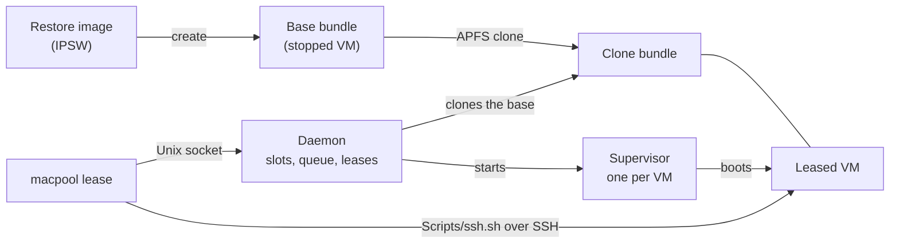

<div align="center">

# macpool

**A clean macOS VM for every job.**<br>
Disposable Mac VMs for coding agents and CI, built on Apple's Virtualization framework.

[](https://github.com/mozharovsky/macpool/actions/workflows/ci.yml)
[](./LICENSE)
[](#requirements)

[Quick start](#quick-start) · [Features](#features) · [How it works](#how-it-works) · [Security](#security) · [Status](#status) · [Docs](./docs/getting-started.md)

</div>

## Overview

A coding agent or a CI job that runs on a Mac changes it. It installs tools, edits settings, and
leaves files and processes behind. The next job then starts on a Mac that nobody prepared for it.
What you want is a clean Mac for each job.

macpool gives you that on Apple silicon. You prepare a macOS VM once. For each job, macpool clones
it, boots the clone, hands it to the job over SSH, and deletes it when the job is done. A job can
install or break anything in its VM, and the next job still starts from the same prepared state.

It's one Swift binary on top of Apple's Virtualization framework and APFS clones.

## Quick start

Check the [requirements](#requirements) first, and run this from the repository root.

```sh
# Build and sign the binary.
Scripts/build.sh
macpool=.build/release/macpool

# Download the newest macOS restore image and install it into a new VM.
# Replace BUILD with the value that fetch prints as restore_build.
$macpool fetch --download
$macpool create --ipsw .cache/ipsw/BUILD.ipsw --bundle .cache/vms/base

# Boot it once to create the guest account, and wait for "ready".
$macpool run --bundle .cache/vms/base --provision --wait-ssh --hold 3600

# In a second terminal, shut the guest down. run then exits.
Scripts/shutdown.sh .cache/vms/base

# Back in the first terminal, start the daemon and leave it running.
$macpool daemon

# In the second terminal, set macpool there too, then lease a fresh clone and open a shell in it.
macpool=.build/release/macpool
$macpool lease --from .cache/vms/base -- sh -c 'Scripts/ssh.sh "$MACPOOL_BUNDLE"'
```

You end up in a shell inside a fresh clone. When you leave the shell, the lease ends and the clone
is deleted. [Getting started](docs/getting-started.md) walks through the same steps and shows
what each one prints.

This is what a lease looks like with a command instead of a shell.

```console
$ .build/release/macpool lease --from .cache/vms/base -- sh -c 'Scripts/ssh.sh "$MACPOOL_BUNDLE" sw_vers'
lease_id=3f9c21ab
bundle=/Users/you/Library/Application Support/macpool/leases/3f9c21ab
address=192.168.64.12
expires_at=2026-11-11T03:06:51Z
ready
ProductName:		macOS
ProductVersion:		27.2
BuildVersion:		26B123
released 3f9c21ab
```

## Features

- **Unattended install.** macpool downloads a restore image, installs macOS, and creates the guest
  account on the first boot without anyone clicking through Setup Assistant.
- **Clones in milliseconds.** A clone is an APFS copy of a stopped VM, and it shares disk blocks
  with its source until one of them writes.
- **Fresh credentials for every clone.** Each clone gets its own guest password and SSH host key
  before it reports `ready`.
- **Leases with a queue and a time to live.** A daemon hands out clones, queues requests while the
  Mac is full, and ends a lease when its time runs out.
- **Restart after a crash.** If a leased VM stops unexpectedly, the daemon boots it again.
- **Shared folders.** You can share a host directory with the guest, read-write or read-only.
- **Leases survive a daemon restart.** Each leased VM runs in its own process and keeps running
  while the daemon restarts.

## What you can do with it

- Give a coding agent its own Mac for each task and throw it away afterwards.
- Run CI jobs on your own Macs, each one in a clean macOS install.
- Try an installer, a profile, or a system setting without touching your own Mac.
- Keep a prepared VM with your tools and hand out copies of it on demand.

## Architecture



## How it works

A **bundle** is a directory that holds one VM. It keeps the disk, the machine's identity, the
settings, and the guest account. `macpool create` installs macOS from a **restore image** into a new
bundle, and the first `macpool run` creates the guest account. Once that bundle has booted and
stopped, it's the **source** you clone from.

A **clone** is an APFS copy of a stopped source with a new machine identifier and MAC address. On
its first boot macpool replaces the password and host key it inherited, and only then prints
`ready`. You can clone and boot by hand with `macpool clone` and `macpool run`.

The **daemon** does that for you. It owns the Mac's VM slots and hands out clones as **leases**.
Each leased VM runs in its own supervisor process. When the lease ends, the daemon stops the VM
and deletes the clone. A job reaches its VM over SSH with `Scripts/ssh.sh`.

## Security

Every clone gets its own random guest password and its own Ed25519 SSH host key on its first boot.
The password stays in the clone's bundle, readable only by you. `Scripts/ssh.sh` pins the host key
in the bundle and refuses any other key.

Until a clone prints `ready`, it still accepts its source's password and host key. Someone who
knows that password could log in during that window. Use a clone only after `ready`.
[Clone credentials](docs/clone-credentials.md) has the details and what to do when the
replacement fails.

## Status

macpool works on one Mac today. These parts don't exist yet.

- One Mac can't lease a VM from another.
- The command line can't run a command in a guest by itself. You go through SSH.
- Prepared VMs have no layers. Each one is a full macOS install.
- There's no packaged release. You build macpool from source.

## Requirements

- A Mac with Apple silicon.
- macOS 27 or later on the host and in every guest.
- Xcode 27.0 to build macpool. The scripts expect it at `/Applications/Xcode_27.0.app`, and you
  can point `DEVELOPER_DIR` at another location.

macOS runs at most two VMs at a time on one Mac. Each one takes its full memory while it runs,
16 GB by default. [Limits](docs/limits.md) lists the rest.

## Going deeper

- [Getting started](docs/getting-started.md). Every quick-start step with the output you should see.
- [Commands](docs/commands.md). Each command and script with its options and defaults.
- [Leases and the daemon](docs/leases.md). Queues, time to live, restarts, and the launchd job.
- [Clone credentials](docs/clone-credentials.md). How a clone gets its own password and host key.
- [Troubleshooting](docs/troubleshooting.md). Logs, stops, and what the daemon does after a failure.
- [Limits](docs/limits.md). What macpool can't do or doesn't protect against.
- [Contributing](CONTRIBUTING.md) and [AGENTS.md](AGENTS.md). Setup, checks, and change rules.

## License

macpool is available under the [MIT license](LICENSE).
